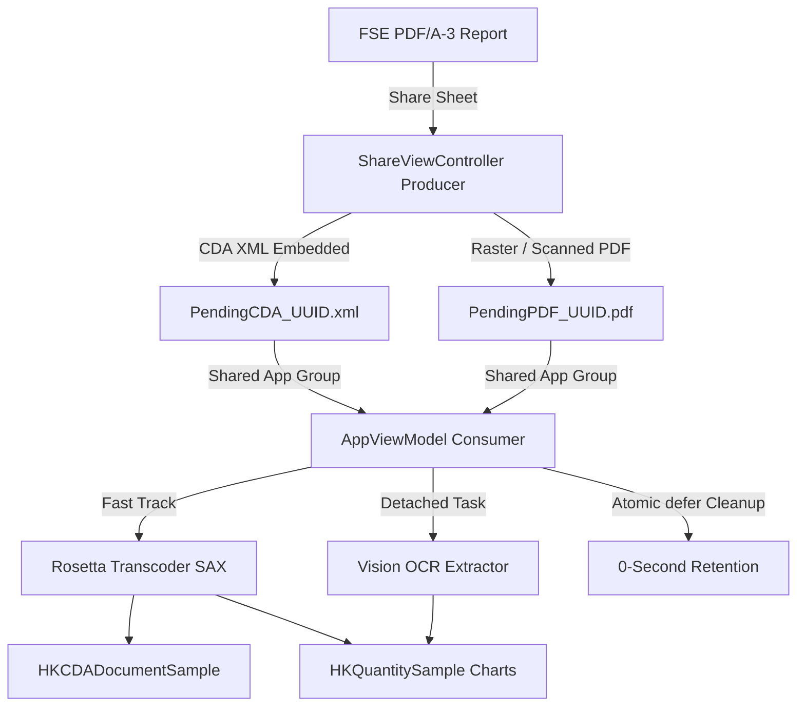

<div align="center">
  
# ⚕️ RosettaHealth 
**Il ponte on-device tra il Fascicolo Sanitario Elettronico (FSE) e Apple Health.**


</div>

<br/>

**RosettaHealth** is not just a parser; it's a secure, invisible pipeline designed to give patients control over their medical data. Built entirely natively in Swift, it extracts complex medical reports from the Italian Electronic Health Record (FSE 2.0) and translates them into actionable, beautiful charts inside Apple Health—all without a single byte ever leaving your iPhone.

---

## 📑 Table of Contents
- [🎯 The Problem & The Solution](#-the-problem--the-solution)
- [🔄 How It Works (The User Journey)](#-how-it-works-the-user-journey)
- [✨ Core Features](#-core-features)
- [📊 Supported Clinical Metrics](#-supported-clinical-metrics)
- [📱 Screenshots](#-screenshots)
- [⚙️ Architecture Overview](#-architecture-overview)
- [🔒 Privacy & GDPR Compliance](#-privacy--gdpr-compliance)
- [🚀 Getting Started](#-getting-started)
- [📋 Requirements](#-requirements)
- [⚖️ License](#-license)

---

## 🎯 The Problem & The Solution

**The Problem:** 
In Italy, when you take a blood test, the results are delivered to your regional *Fascicolo Sanitario Elettronico (FSE)* as a PDF. Buried inside that PDF is an **HL7 CDA R2 XML** file—a clinically accurate standard that is virtually unreadable to the average human and completely ignored by modern consumer tech. If you want to track your cholesterol trend over five years, you have to manually open dozens of PDFs and write the numbers down. 

**The Solution (RosettaHealth):** 
We built an on-device translation engine. RosettaHealth intercepts the FSE PDF via an iOS Share Extension, digs out the XML, and transcodes it to the modern **HL7 FHIR R4** standard (specifically injecting **EU IPS Profiles** for cross-border interoperability). Finally, it injects the numerical values directly into **Apple HealthKit**. 

The result? Your legacy government PDF instantly becomes an interactive, long-term health chart on your iPhone.

---

## 🔄 How It Works (The User Journey)
1. **Download**: The user downloads a lab report (PDF) from their regional FSE portal.
2. **Share**: Without leaving Safari or the Files app, the user taps the iOS Share Button and selects "RosettaHealth".
3. **Parse**: The Share Extension instantly queues the file. The next time the main app is opened, it unpacks the XML, transcodes it to FHIR, and maps the observations.
4. **Visualize**: The clinical metrics seamlessly appear in the native Apple Health app as interactive, long-term charts.

---

## ✨ Core Features 
* **Native PDF/A-3 Extraction**: Automatically traverses the PDF CoreGraphics catalog to extract embedded medical XMLs without heavy third-party dependencies. 
* **Dual-Track HealthKit Ingestion**: 
  - **Full Clinical Archiving (`HKCDADocumentSample`)**: Stores the complete official CDA report directly in Apple HealthKit. 
  - **Selective Quantitative Metrics (`HKQuantitySample`)**: Translates structured numerical observations into native historical charts. 
* **On-Device Transcoding (Rosetta Engine)**: Implements Microsoft FHIR-Converter semantics natively in Swift, transforming CDA R2 into validated FHIR R4 JSON Bundles.
  - **🇪🇺 EU Cross-Border Interoperability**: Automatically injects **IPS (International Patient Summary)** metadata profiles (`Bundle-uv-ips`, `Composition-uv-ips`), ensuring the generated JSON is strictly compliant with international healthcare mobility standards.
* **🔒 Biometric Security (FaceID/TouchID)**: Healthcare data demands the highest privacy standards. The app automatically blurs clinical data in the iOS task switcher and locks the Vault using `LocalAuthentication` whenever the app goes to the background.
* **👨‍👩‍👧‍👦 Multi-Profile Safety & Family Vault (SwiftData)**: Protects your Apple Health database from third-party data pollution. Reports belonging to family members are intelligently routed away from HealthKit and saved exclusively into an encrypted on-device **Family Vault**, creating a centralized EMR timeline for the whole family.
* **🤖 Graceful Degradation (Apple Vision OCR)**: Extracts key parameters (Glucose, Cholesterol, Blood Pressure) from scanned/raster PDFs lacking embedded XML, with full provenance audit trailing. 
* **📤 Share Extension & Safe IPC**: Extract and queue medical data in a single tap directly from Safari, Mail, or the Files app using iOS Share Sheets. 
* **🎨 Modern SwiftUI Interface**: Built with the latest Apple Human Interface Guidelines, featuring Glassmorphism, continuous squircle shapes, and native typographic designs.

---

## 📊 Supported Clinical Metrics
The internal `HealthKitBridge` uses a static mapping engine to translate standard **LOINC** codes into Apple's `HKQuantityTypeIdentifier`.

| Metric Name | LOINC Code | Apple HealthKit Identifier | Unit |
|---|---|---|---|
| **Glucose** | `15074-8` / `2345-7` | `bloodGlucose` | mg/dL |
| **Cholesterol (Total)** | `2093-3` / `35200-5` | `dietaryCholesterol` | mg/dL |
| **Blood Pressure (Systolic)** | `8480-6` / `85354-9` | `bloodPressureSystolic` | mmHg |
| **Blood Pressure (Diastolic)** | `8462-4` / `85354-9` | `bloodPressureDiastolic` | mmHg |
| **Heart Rate** | `8867-4` | `heartRate` | bpm |
| **Oxygen Saturation** | `2708-6` / `59408-5` | `oxygenSaturation` | % |

*(Additional LOINC mappings can be added natively in `HealthKitBridge.swift`)*

---

## 📱 Screenshots
*(Aggiungi qui gli screenshot dell'app una volta in esecuzione su Xcode)*

<p align="center">
  
  &nbsp;&nbsp;&nbsp;&nbsp;
  
  &nbsp;&nbsp;&nbsp;&nbsp;
  
</p>

---

## ⚙️ Architecture Overview
RosettaHealth employs an asynchronous **Dual-Track Producer-Consumer IPC pattern** to navigate iOS sandbox and memory constraints (Jetsam mitigation): 



- **Producer (Share Extension)**: Identifies payload format with zero memory overhead, saving either `PendingCDA_*.xml` or `PendingPDF_*.pdf` into the encrypted App Group container (`group.dev.alexmaina.rosettahealth`).
- **Consumer (AppViewModel)**: Scans the shared container on `.scenePhase` activation, orchestrates SAX parsing / Vision OCR pipelines, writes to HealthKit, and atomically removes intermediate files (`defer`).

Per un approfondimento ingegneristico, consulta il [Technical Design Document](Technical_Design_Document_v3.md).

---

## 🔒 Privacy & GDPR Compliance
RosettaHealth processes sensitive health data (GDPR Art. 9) with absolute strictness:
- **Zero-Cloud Architecture**: No network capabilities (`URLSession`) are implemented. Everything happens locally.
- **Hardware Encryption**: Files in the App Group container are forcibly encrypted using `NSFileProtectionCompleteUntilFirstUserAuthentication`.
- **Zero-Retention Pipeline**: Intermediate `.xml` and `.pdf` files are atomically destroyed (`defer`) immediately after successful injection into Apple Health. The app holds no data at rest, acting purely as a secure translation pipe.

---

## 🚀 Getting Started

### 1. Clone the repository
```bash
git clone https://github.com/AlexMaina05/RosettaHealth.git
```

### 2. Open in Xcode
Drag the `Sources` package into a new iOS App project, or open the Swift Package directly.

### 3. Configure Capabilities
In your Xcode Target settings, ensure the following are enabled for both the Main App and the Share Extension:
- **HealthKit** *(Main App only, standard capability)*
- **App Groups** (`group.dev.alexmaina.rosettahealth` applied to both targets)

### 4. Update Entitlements
Ensure `NSFileProtectionCompleteUntilFirstUserAuthentication` is configured to allow Share Extension background operations.

---

## 📋 Requirements
- **iOS 17.0+** 
- **Xcode 15.0+** 
- **Swift 5.10+** *(Swift 6 Concurrency Safe)* 
- Active Apple Developer Account *(for App Groups and HealthKit capabilities)* 

---

## ⚖️ License
This project is licensed under the **GNU General Public License v3.0** with an explicit Apple App Store Exception. See the [LICENSE](LICENSE) file for details.
