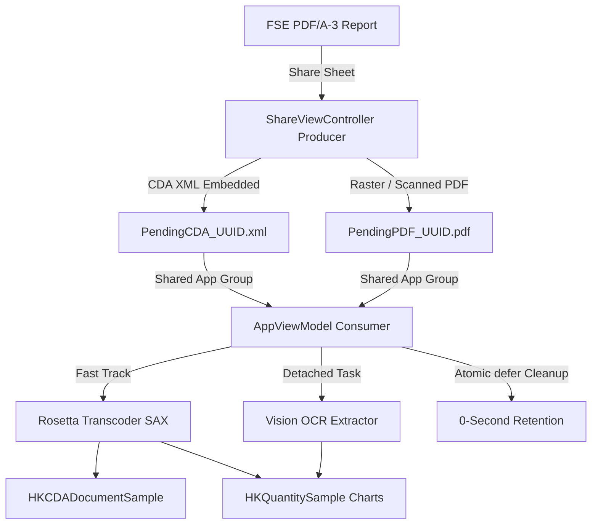

# RosettaHealth 🩺 

**RosettaHealth** is a 100% on-device iOS application and Share Extension that bridges the gap between the Italian Electronic Health Record (FSE 2.0) and modern health ecosystems like Apple Health (HealthKit). It seamlessly extracts HL7 CDA R2 XML payloads embedded within FSE PDF/A-3 reports, transcodes them to standard **HL7 FHIR R4**, and securely ingests the clinical observations directly into Apple HealthKit—without relying on any cloud processing, ensuring strict compliance with GDPR Art. 9 data minimization principles. 

## Features ✨ 
- **Native PDF/A-3 Extraction**: Automatically traverses the PDF CoreGraphics catalog to extract embedded medical XMLs without heavy third-party dependencies. 
- **Dual-Track HealthKit Ingestion**: 
  - **Full Clinical Archiving (`HKCDADocumentSample`)**: Stores the complete official CDA report directly in Apple HealthKit. 
  - **Selective Quantitative Metrics (`HKQuantitySample`)**: Translates structured numerical observations into native historical charts. 
- **On-Device Transcoding (Rosetta Engine)**: Implements Microsoft FHIR-Converter semantics natively in Swift, transforming CDA R2 into validated FHIR R4 JSON Bundles. 
- **Graceful Degradation (Apple Vision OCR)**: Extracts key parameters (Glucose, Cholesterol, Blood Pressure) from scanned/raster PDFs lacking embedded XML, with full provenance audit trailing. 
- **Share Extension & Safe IPC**: Extract and queue medical data in a single tap directly from Safari, Mail, or the Files app using iOS Share Sheets. 
- **Offline & Private by Design**: Zero network calls. No `URLSession`. All processing happens within your device's Secure Enclave and local sandbox with hardware-level data protection. 
- **Modern SwiftUI Interface**: Built with the latest Apple Human Interface Guidelines, featuring Glassmorphism, continuous squircle shapes, and native typographic designs. 

## Requirements 📋 
- **iOS 17.0+** 
- **Xcode 15.0+** 
- **Swift 5.10+** (Swift 6 Concurrency Safe) 
- Active Apple Developer Account (for App Groups and HealthKit capabilities) 

## Architecture Overview 🏗️ 
RosettaHealth employs an asynchronous **Dual-Track Producer-Consumer IPC pattern** to navigate iOS sandbox and memory constraints (Jetsam mitigation): 



- **Producer (Share Extension)**: Identifies payload format with zero memory overhead, saving either `PendingCDA_*.xml` or `PendingPDF_*.pdf` into the encrypted App Group container (`group.dev.alexmaina.rosettahealth`).
- **Consumer (AppViewModel)**: Scans the shared container on `.scenePhase` activation, orchestrates SAX parsing / Vision OCR pipelines, writes to HealthKit, and atomically removes intermediate files (`defer`).

## Getting Started 🚀

### Clone the repository:
```bash
git clone https://github.com/AlexMaina05/RosettaHealth.git
```

### Open in Xcode:
Drag the `Sources` package into a new iOS App project, or open the Swift Package directly.

### Configure Capabilities:
In your Xcode Target settings, ensure the following are enabled for both the Main App and the Share Extension:
- **HealthKit** (Main App only, standard capability)
- **App Groups** (`group.dev.alexmaina.rosettahealth` applied to both targets)

### Update Entitlements:
Ensure `NSFileProtectionCompleteUntilFirstUserAuthentication` is configured to allow Share Extension background operations.

For deeper architectural details, refer to the [Technical Design Document](Technical_Design_Document_v3.md).

## License 📜
This project is licensed under the GNU General Public License v3.0 with an explicit Apple App Store Exception - see the [LICENSE](LICENSE) file for details.
